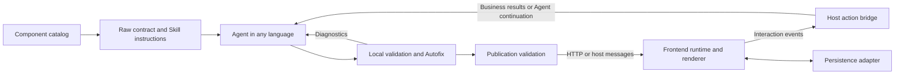

# Intelligence UI Product and Implementation Plan

Status: Implemented in 0.3.0, with open items listed under Implementation Status  
Date: 2026-10-21 (status updated 2026-10-22)  
Audience: Maintainers, Agent developers, frontend developers, and integration developers

Intelligence UI will provide a language independent protocol and a practical toolchain for Agent generated interactive interfaces. Agents produce structured UI documents, application backends deliver them, and a browser renderer presents interactive cards and returns structured user actions. The Agent, backend, and frontend may use different languages and run in separate processes, machines, or organizations.

The release will combine a core npm package, downloadable protocol artifacts, a validation and Autofix CLI, an MCP service, an Agent Skill, and working integration examples. Raw integration is a complete supported path. Skill and MCP integrations reuse the same contracts and validation behavior.

The first release must deliver a working generation, validation, rendering, interaction, and update cycle. It must resolve generation errors before publication wherever possible, without making the live frontend part of an Agent repair loop.

## Product Goals

1. Let Agent developers add interactive UI without adopting a particular model provider, Agent framework, backend language, database, or chat interface.
2. Give frontend developers a renderer with useful built in components, default styles, state handling, and a small integration API.
3. Make Raw, Skill, and MCP integration equally valid ways to access the same product capabilities.
4. Move structural, semantic, capability, and policy validation ahead of publication.
5. Provide deterministic Autofix for unambiguous errors and actionable suggestions for errors that require Agent reasoning.
6. Support links, images, forms, single and multiple choices, tables, and external web previews.
7. Preserve user input when compatible documents are updated.
8. Keep business execution, authentication, authorization, and conversation orchestration under the host application's control.

### First Release Exclusions

The first release will not require a hosted model gateway, a proprietary backend service, or a complete replacement chat application. It will not execute arbitrary model generated JavaScript in the standard component renderer.

Executable applications, represented by a future AppBlock capability, require a separate sandbox design and are outside the first release. MCP Apps presentation, the container image, and Go and Java examples follow in a later release. Visual editors, extensive domain specific component libraries, native mobile renderers, and full SDKs for every backend language are also deferred.

Streaming is an enhancement to the document delivery protocol. The initial release may publish complete document snapshots. It must not depend on rendering malformed partial JSON or executing incomplete programs.

## Current Repository Baseline

Before this work the repository contained the `@haowei2000/intelligence-ui` package at version `0.2.0`; the table records that starting point.

| Area | Existing capability | Required change |
| --- | --- | --- |
| Document format | InteractiveDocument with metadata, decisions, state, references, analysis, HTML, and CSS | Introduce a separate component document protocol with explicit compatibility rules |
| Browser rendering | Shadow DOM renderer with custom fields and decision cards | Render a registered component tree and provide component capabilities |
| React integration | Controlled DocumentRenderer with lifecycle and persistence callbacks | Add a separate component protocol entry; leave the existing entry unchanged |
| State and persistence | Field bindings, selections, debounce, serial saves, retries, and revision synchronization | Reuse behavior where appropriate and define cross language event and update semantics |
| Validation | Document validation that throws on invalid data | Add complete diagnostics, semantic checks, capability checks, and Autofix |
| Agent support | AI provider adapter and Studio document regeneration | Extract reusable contracts and integration adapters |
| Links and images | Removed by the embedded HTML renderer | Provide explicit Link and Image components |
| Web previews | No embedded component support | Add a controlled WebPreview component |
| Distribution | Browser, React, document, Node, and CLI package entries | Add protocol and Agent toolchain entries and publish supporting artifacts |

Ajv has been added as a preparatory dependency. It is used at build time to generate precompiled standalone validators; runtime code must not compile schemas, because Ajv's compiler uses `new Function` and fails under a content security policy without `unsafe-eval`, including MCP Apps iframes. The new component protocol, Autofix engine, Raw contract, and MCP integration are not implemented yet. The current Studio remains an optional development tool.

## Implementation Status

Package `0.3.0` implements P0 through P4 except the items marked open. Run `npm test` (140+ tests), `npm run check:types`, `npm run check:generated` and, with Python and a browser installed, `npm run check:browser` (Chrome), `npm run check:browser:firefox` or `npm run check:browser:safari`.

| Milestone | Delivered | Where |
| --- | --- | --- |
| P0 | `components.json` source of truth; generated schemas, types, precompiled validators, contract, instructions and component reference; diagnostic, repair and version formats; examples; conformance cases; semantic rules | `protocol/`, `scripts/generate.mjs`, `docs/protocol.md` |
| P1 | Parser, structural, semantic, capability and policy validation; bounded diagnostics; deterministic Autofix; bounded model repair loop; Raw contract export; CLI with documented exit codes | `lib/protocol/`, `agent.mjs`, `lib/cli.mjs`, `docs/autofix.md` |
| P2 | 18 components (including Chart); uncontrolled browser runtime; React wrapper; form scope and typed submission; host actions with status; three-way merge with every table row tested; WebPreview with policy sandbox; axe-core audit of every component | `lib/runtime/`, `test/runtime.test.mjs`, `test/accessibility.test.mjs` |
| P3 | HTTP delivery service with SSE, event re-validation, deduplication, cursor event log, state saves; MCP over stdio and stateless HTTP, tested with the official SDK client; Agent Skill; TypeScript and Python Agents; separately hosted frontend; automated Python round trip | `lib/service/`, `skill/intelligence-ui/`, `examples/protocol/`, `test/e2e.test.mjs` |
| P4 | Quick start, protocol, Autofix, deployment, security and migration guides; Playground; export and packaging checks; clean install verified from the packed tarball; Chrome, Firefox and Safari checks; SQLite store | `docs/`, `playground/`, `test/package.test.mjs`, `scripts/browser-check.mjs`, `lib/service/sqlite-store.mjs` |

Open items:

- **Structured output experiment (P0 gate):** 1 of 3 providers tested. Zhipu GLM accepted the canonical recursive schema in strict mode with 9 of 9 valid outputs ([results](experiments/structured-output.md)). Two more providers are needed; the recursive schema stays provisional until they pass.
- **Milestone owners and estimates:** not assigned.
- **Screen readers:** `npm run check:browser` (Chrome), `check:browser:firefox` and `check:browser:safari` run the Playground and the full Agent, service and frontend cycle, including strict CSP, keyboard selection, phone width and color contrast; CI runs Chrome and Firefox, and Safari runs locally on macOS (contrast in the system appearance only). Screen readers have not been tested.
- **Distributed store:** `MemoryUIStore` and `SqliteUIStore` (one machine) ship; hosts running on several machines implement `UIStore` on their database.

## Release Deliverables

### Protocol Specification and Raw Contract

Publish versioned files that developers can consume without importing JavaScript:

```text
protocol/
  contract.json
  ui-document.schema.json
  interaction-event.schema.json
  delivery.schema.json
  components.json
  instructions.md
  semantic-rules.md
  examples/
  conformance/
```

The contract describes the protocol version, supported components and properties, registered actions, enabled capabilities, limits, and applicable policies. JSON Schema describes portable structural constraints. Semantic rules and conformance fixtures describe constraints that JSON Schema alone cannot fully express.

`components.json` is the single source of truth. The JSON Schemas, TypeScript types, precompiled validators, contract, and component reference documentation are generated from it, and a contract consistency test fails when generated files are stale.

Static release contracts describe standard component profiles. Deployment contracts describe the components and actions actually registered by a particular host. The Agent must use the deployment contract when it is available.

### Core npm Package

Keep one core package with separate import entries so applications only load the functionality they need. The following entries are planned; their exact API names will be finalized during protocol design.

| Entry | Responsibility |
| --- | --- |
| `@haowei2000/intelligence-ui/protocol` | Protocol types, schema access, component metadata, and capability definitions |
| `@haowei2000/intelligence-ui/agent` | Contract generation, parsing, validation, Autofix, and Agent repair feedback |
| `@haowei2000/intelligence-ui/runtime` | Framework independent component renderer and controller |
| `@haowei2000/intelligence-ui/runtime/react` | React component renderer and lifecycle integration |
| `@haowei2000/intelligence-ui/node` | Optional HTTP, persistence, Studio, and service helpers |

The existing root, `browser`, `react`, and `document` entries keep serving the legacy InteractiveDocument renderer unchanged; the component protocol uses the new entries above rather than repurposing them. The runtime entries must not import filesystem APIs, server code, model providers, or a schema compiler; they use precompiled validators. Chart geometry is isolated in a dependency-free SVG renderer; the standard runtime includes it without a third-party chart library.

### CLI

Provide commands to export contracts, validate documents, and apply deterministic fixes. The CLI must support stdin and file input, machine readable JSON output, documented exit codes, and no in place writes unless explicitly requested.

The first CLI can ship through npm and require Node.js. Developers using other languages can instead use static artifacts, MCP, or HTTP. Native standalone executables can be evaluated later.

Existing Studio CLI behavior must remain compatible, either through separate executable names or backward compatible command dispatch.

### MCP Service

Provide an executable service. Support local stdio connections and remote HTTP deployments through appropriate adapters. Both transports use the same application contracts and validation engine.

The service exposes capability discovery, validation, Autofix, document publication, and interaction retrieval. MCP Apps presentation and a container image follow in a later release. Ordinary MCP support alone does not guarantee that a host can render interactive UI.

### Agent Skill

Publish a portable Skill containing generation rules, component guidance, examples, and the validation and repair workflow. It must explain how to use available CLI, HTTP, or MCP connections without assuming a specific Agent product.

The Skill must use the current deployment contract where available. Installing a Skill does not create a frontend connection, grant credentials, or guarantee that a particular action is available.

### Documentation and Examples

Publish a quick start, component reference, protocol reference, Autofix guide, deployment guide, security guide, and migration guide. Include runnable TypeScript and Python examples and a frontend and backend separation example. Go and Java examples follow in a later release.

A Playground demonstrates the product and helps inspect documents, diagnostics, applied fixes, events, and updates. It is optional for production consumers.

## Architecture and Module Boundaries



| Module | Responsibility | Boundary |
| --- | --- | --- |
| Protocol and component catalog | Define documents, components, bindings, actions, capabilities, and versions | No frontend framework or model provider dependency |
| Agent injection | Generate instructions, schemas, examples, and tool contracts | Does not own model credentials or conversation history |
| Parsing and validation | Parse input and produce structural, semantic, capability, and policy diagnostics | Does not render, publish, execute actions, or silently change business meaning |
| Autofix | Apply declared deterministic repairs and propose other repairs | Does not publish candidates or invent missing business information |
| State runtime | Manage field values, local interactions, visibility, and compatible updates | Does not execute arbitrary expressions or authorize business operations |
| Rendering | Map registered components and current state to accessible UI | Does not depend on how the Agent was invoked |
| Host bridge and delivery | Route documents and events, invoke registered actions, and report execution status | Host owns authentication, authorization, routing, and Agent scheduling |
| Persistence | Save and restore documents and state with revision handling | Storage technology remains replaceable |
| Security policy | Apply limits, URL rules, capability restrictions, and sandbox boundaries | Enforced across parsing, publication, rendering, and execution |

These are logical modules, not a requirement to publish separate packages or services. A host may embed delivery and persistence into its existing backend.

## Protocol Requirements

### UI Document

The Agent authors a candidate: an explicit schema version, a component root, read only datasets, and per field `default` values. The host owns everything that makes a candidate a committed document: the document ID, the committed revision, and current interaction state. Read only datasets are separate from mutable form values. Host routing and credentials are not part of the Agent authored component tree.

Defaults and state are deliberately separate. A `default` applies only to a field that has no user value; it never overwrites state (see State Updates).

The following example illustrates the intended candidate shape. Field names remain subject to the P0 schema review.

```json
{
  "schemaVersion": "1.0",
  "root": {
    "type": "Card",
    "id": "trip-card",
    "title": "Trip plan",
    "children": [
      {
        "type": "Form",
        "id": "trip-form",
        "submitAction": "submit-plan",
        "children": [
          {
            "type": "Choice",
            "id": "destination-choice",
            "bind": "destination",
            "mode": "single",
            "display": "buttons",
            "default": "berlin",
            "options": [
              { "value": "berlin", "label": "Berlin" },
              { "value": "paris", "label": "Paris" }
            ]
          },
          {
            "type": "Button",
            "id": "submit-trip",
            "label": "Continue",
            "action": { "type": "submit" }
          }
        ]
      }
    ]
  }
}
```

After publication the host wraps the candidate in a committed document:

```json
{
  "id": "trip-plan",
  "revision": 1,
  "document": { "schemaVersion": "1.0", "root": { "type": "Card", "id": "trip-card" } },
  "state": { "values": { "destination": "berlin" }, "dirty": [] }
}
```

`state.dirty` lists bindings the user changed since the last committed revision; it drives the merge described under State Updates. Autofix and validation never add `id`, `revision`, or `state` to a candidate.

Component IDs must be unique within a document. Option and tab identifiers must be unique within their respective containers. Bindings must follow a documented field naming and ownership model.

The first version should use flat field keys and explicit references rather than arbitrary JavaScript or implicit string interpolation. Conditional visibility uses a restricted declarative condition. Complex calculations and transformations can be performed by host code and supplied as data.

### Delivery

Delivery must be independent of Agent transport. A validated document can arrive through an HTTP response, an event stream, a tool result, or a host message.

The delivery contract must identify the document, committed revision, message type, and applicable capability contract. It must distinguish a proposed candidate from a committed document. Unknown protocol majors, incompatible capabilities, stale updates, and revision conflicts produce explicit outcomes.

The host binds delivery to an authenticated user, conversation, message, and UI surface. Agent supplied IDs alone must not authorize delivery to another user's surface.

Start with complete committed snapshots. Introduce patches or incremental component batches only after their ordering, atomicity, validation, and state preservation semantics are specified.

### Interaction Events

Events contain a unique event ID, document ID, base revision, source component ID, action ID, and validated submitted values.

```json
{
  "eventId": "evt-456",
  "documentId": "trip-plan",
  "baseRevision": 1,
  "sourceId": "submit-trip",
  "actionId": "submit-plan",
  "values": { "destination": "berlin" }
}
```

Values validated in the browser are untrusted. The host must re-validate submitted values against the form scope and field types of the committed revision named by `baseRevision`, then handle deduplication, authorization, and revision conflicts before executing business operations.

Event acceptance, business execution, and Agent completion are distinct states. Define pending, successful, and failed outcomes so the UI can provide useful feedback. A user action must not require a long lived model tool call to remain open while waiting for human input.

### State Updates

Input, choice selection, tab switching, and disclosure expansion run locally without a model call. Persistence is optional and does not imply Agent invocation.

Compatible updates preserve existing user values using stable field bindings and component IDs. Applying a new revision is a three way merge per binding between the last committed revision (base), local edits (dirty bindings), and the incoming document:

| Binding situation | Outcome |
| --- | --- |
| Not dirty, still present and type compatible | Take the incoming value, or the new `default` when the incoming document has no value |
| Dirty, still present and type compatible | Keep the local value; a new `default` never replaces it |
| Dirty, but the incoming choice no longer offers the selected value | Keep the field dirty, clear the value, and report a `value-removed` outcome to the host |
| Removed from the incoming document | Archive the local value and report it; do not discard silently |
| Type changed incompatibly | Archive the local value and report a `type-changed` outcome |
| Explicit reset requested by the host | Discard local values for the named bindings only |

Pending saves are not cancelled by a compatible update; they are rebased onto the new revision. The legacy renderer, which discards unsaved edits when a different document arrives, must not be reused for this path.

The runtime owns current editable state; it is uncontrolled. Hosts supply the committed document and receive changes through events and persistence callbacks; there is no controlled `value` round trip for state. This avoids the class of bugs where a stale controlled value overwrites newer edits. The legacy controlled DocumentRenderer remains for the legacy format only.

## Component Catalog

### Catalog Design Rules

Each component needs a distinct semantic responsibility, a schema, a rendering contract, accessibility behavior, state or action behavior, and conformance examples. Properties handle presentation variants where the underlying semantics are the same.

Use Stack direction instead of separate Row and Column types. Use Text variants instead of separate Heading, Paragraph, Caption, and CodeBlock types. Use Input kind and multiline behavior instead of unrelated types for every text entry variant. Use Choice mode and display instead of separate RadioGroup, CheckboxGroup, and Select components.

Keep Toggle distinct from Choice because it represents a boolean. Keep Link distinct from Button because navigation and action execution have different contracts. Keep WebPreview distinct from AppBlock because external page embedding and executing generated applications have different trust boundaries.

### Standard Components

| Category | Components | Required behavior |
| --- | --- | --- |
| Layout | Stack, Grid, Card, Divider | Direction, spacing, responsive layout, grouping, and separation |
| Content | Text, Image, Link | Text variants, accessible image descriptions, and navigable URLs |
| Input | Input, Choice, Toggle, Slider | Typed bindings, constraints, single or multiple selection, boolean values, and numeric ranges |
| Forms and actions | Form, Button | Submission scope, validation feedback, explicit actions, and pending states |
| Content organization | Tabs, Disclosure | Keyboard navigation, local selection, and expansion state |
| Data display | Table, Chart | Dataset references, validated numeric mappings, accessible chart data tables, and useful empty states |
| External content | WebPreview | Controlled iframe embedding and an available open original link |

The current catalog contains 18 component types, including Chart with an isolated SVG renderer. Every standard component must have at least one valid example, invalid examples, a renderer implementation, and an accessibility check before being advertised by the standard runtime profile.

### Component Specific Constraints

- Input must define its value type for each kind. Multiline applies to text input rather than creating a separate Textarea type. Empty numeric values need an explicit representation.
- Choice must define string versus string array values, unique option values, allowed display modes, and minimum or maximum selection behavior where supported.
- Slider must define numeric bounds and step behavior. Invalid bounds must be rejected before rendering.
- Form must define which fields it submits. Nested forms are invalid. Submit and reset buttons must resolve to a form.
- Button must reference a declared host action or an explicitly supported local operation. It cannot contain executable handlers.
- Table must define columns, stable row identity where required, and dataset shape. Sorting and selection must have explicit local or host behavior.
- Chart supports line, bar, and pie presentations. Dataset mappings and numeric requirements must be checked before publication. Additional chart families remain extensions until their contracts are defined.
- Tabs must define unique tab IDs and an active tab that exists. Disclosure must have a usable accessible label.
- Image, Link, and WebPreview must apply host URL policy. Resource availability remains a runtime concern.

### Extensions

Hosts may register custom components using namespaced identifiers, trusted schemas, rendering implementations, and optional semantic validators. A host advertises an extension only after all required pieces are registered.

Do not add a generic raw HTML component to bypass missing standard features. Maps, uploads, domain specific cards, and richer editors can use registered extensions. AppBlock requires a separately enabled sandbox capability in a later release.

Unknown component types produce a diagnostic. Suggested alternatives may be returned to the Agent, but automatic repairs must not silently replace unknown components with different semantics.

## Raw Injection and Agent Integration

### Raw Integration

Raw integration must work without a Skill, MCP connection, or JavaScript backend. A developer obtains the contract, adds the generated instructions to the Agent's existing instructions, and supplies the schema through the model or Agent framework's supported structured output mechanism.

Where structured output is unavailable, the Agent can return JSON text and rely on parsing and validation. In both cases the application validates the result before publication.

The Raw contract must include:

- Protocol and capability versions.
- Enabled components, properties, registered actions, and limits.
- Generation instructions and complete examples.
- Portable schemas and semantic rules.
- The validation result and Autofix result formats.
- Repair guidance that can be added to a subsequent Agent turn.

Raw instructions must be additive to the host's existing instructions. They must not take ownership of unrelated Agent behavior, credentials, or conversation history.

### Skill Integration

The Skill workflow is: discover the target contract, generate a document, validate locally where possible, apply deterministic fixes, resolve remaining diagnostics, and publish once valid.

Provide references and scripts as optional supporting files. Scripts must report dependency requirements and machine readable results. Credentials come from the Agent environment or configured connection, never from the Skill text.

When the deployment contract differs from the bundled examples, the Skill must use the deployment contract. Capability discovery should normally happen once per task or session and be refreshed when the contract changes.

### MCP Integration

The following tool responsibilities are planned. Exact names are part of P0 review.

| Tool | Responsibility |
| --- | --- |
| `ui_get_capabilities` | Return the deployment contract and version identifiers |
| `ui_validate` | Return diagnostics without publishing or mutating stored documents |
| `ui_fix` | Return a repaired candidate, applied fixes, and unresolved diagnostics |
| `ui_publish` | Revalidate, enforce revision rules, commit, and deliver a document |
| `ui_read_events` | Retrieve interaction events where host initiated continuation is unavailable |

Tool names use only `[a-z0-9_]` because hosts often forward MCP tools into model function calling APIs that reject dots.

`ui_read_events` takes an opaque cursor and returns events after it plus the next cursor. Events stay retrievable until acknowledged by passing a later cursor, or until a documented retention period expires; expiry is reported rather than silently skipped.

Validation and fix tools are optional preparation steps. Do not require a remote validate call followed by a remote publish call on every successful generation. Publication always validates, so an Agent without local execution can submit directly and repair rejected candidates from tool diagnostics.

In a later release, MCP Apps hosts receive a trusted UI Resource containing the generic renderer, with the document passed as data. For independent frontends, the MCP service uses an HTTP or application message delivery adapter. Both paths consume the same UI document.

Unsupported hosts need a documented text or preview link fallback. MCP tool responses alone must not be presented as universal inline UI support.

## Validation and Autofix

### Validation Stages

| Stage | Examples |
| --- | --- |
| Parsing | Malformed JSON, unsupported input type, incomplete input, and input size limits |
| Structural validation | Wrong property types, missing required fields, unknown properties, and unsupported protocol version |
| Semantic validation | Duplicate IDs, invalid bindings, unknown actions, invalid selected values, invalid datasets, and illegal component nesting |
| Capability validation | Components, properties, actions, and optional features unavailable in the target host |
| Policy validation | URL schemes, allowed origins, document complexity, resource limits, and executable content restrictions |
| Publication validation | Current capability contract, document revision, authenticated destination, and commit preconditions |

Return independent errors together where traversal can continue safely. Once a resource or traversal limit is reached, stop predictably and report that diagnostics were truncated.

### Diagnostic Contract

A diagnostic includes a stable code, JSON Pointer path, severity, readable explanation, expected constraints, and a suggested resolution. Include actual values only when useful and safe; avoid copying large or sensitive payloads into diagnostics.

```json
{
  "valid": false,
  "diagnostics": [
    {
      "code": "UNREGISTERED_ACTION",
      "path": "/root/children/0/submitAction",
      "severity": "error",
      "message": "The action is not registered by this host.",
      "expected": { "allowed": ["submit-plan"] },
      "suggestion": "Use a registered action that matches the intended operation, or remove the submission action."
    }
  ]
}
```

The result must distinguish a valid document from an untrusted candidate. Invalid candidates must not accidentally occupy the same accepted result field used by publication and rendering callers.

### Deterministic Repairs

Autofix operates on a detached copy and reports every applied change. Each repair has a stable rule ID, target path, reason, and an auditable change description or patch.

Eligible repairs include removing a complete surrounding Markdown JSON fence and adding an explicitly declared default whose meaning is unambiguous. Defaults must be distinguished from inferred business values. Missing identity, revision, user state, action targets, and required business data are not generic defaults.

Autofix must not silently:

- Invent IDs or business data.
- Rename IDs and change references to guess the author's intent.
- Change action IDs to superficially similar names.
- Drop unknown properties or components to make the document pass.
- Remove selected values or clear existing user input.
- Convert malformed or truncated JSON into a different guessed document.
- Enable additional host permissions or network access.

The repair result reports the candidate, applied fixes, remaining diagnostics, and whether the candidate is valid. Applying Autofix again to its output must be idempotent.

### Agent Repair Suggestions

For ambiguous errors, return concise explanations, valid alternatives, and optional proposed patches with explicit preconditions. Suggestions are advisory and must not be applied as deterministic repairs.

An optional host supplied model repair callback can use these diagnostics. It must have a bounded retry count, cancellation support, and a clear failure result. Deterministic Autofix itself must not require a model call or network connection.

### Publication Boundary

The publication sequence is: verify the capability contract, validate the complete candidate, check revision and destination preconditions, commit, and notify the frontend.

Rejected candidates must not create live UI updates or overwrite the last valid document. Publication acceptance means the document was committed for delivery; it does not mean that all clients have rendered it or that all external resources loaded.

The frontend keeps lightweight defensive checks and runtime error handling. It should not become the normal mechanism for discovering generation errors.

## Web Preview and Runtime Security

WebPreview embeds an external URL through a host configured iframe. Host policy controls permitted origins, sandbox permissions, navigation behavior, and any bridge capabilities. The Agent cannot grant iframe permissions through arbitrary attributes. Host policy must reject `allow-scripts` combined with `allow-same-origin` for any origin the host page shares, because together they let the framed page remove its own sandbox. Hosts must also list permitted preview origins in their page's CSP `frame-src`; the integration guide documents this.

An external site may forbid embedding or require authentication unavailable in the frame. Always provide a usable open original link and a fallback presentation for known failures. Do not promise that every embedding failure can be reliably detected from a cross origin parent page.

Cross origin previews do not automatically expose their contents or user actions to the Agent. Cooperative messaging requires an explicitly supported bridge and message validation.

Shadow DOM provides style scoping, not isolation for executable applications. A future AppBlock implementation requires its own origin, sandbox, content security policy, lifecycle, resource budget, and audited bridge.

Additional security requirements include:

- Bound document bytes, component count, nesting depth, dataset size, string lengths, and validation work.
- Reject unsafe object keys and binding paths that could lead to prototype manipulation.
- Validate URLs and allow only configured schemes and origins for each resource type.
- Keep arbitrary JavaScript, event handlers, and unreviewed raw CSS out of standard documents.
- Reject external schema resolution and untrusted executable component registrations.
- Validate host messages and their origins or channels; do not accept arbitrary page messages as trusted actions.
- If a host fetches URLs on behalf of a preview or image, apply server side request policy and limits rather than treating client URL validation as sufficient.
- Recheck business authorization when actions execute, regardless of prior document validity.

## Cross Language Support

JSON contracts are the integration boundary. A Python, Go, or Java backend must not need to import JavaScript functions or share React objects with the frontend.

Developers have three validation options:

1. Run a compatible native schema validator and implement the published semantic rules, checked against the conformance fixtures.
2. Invoke the shared CLI as a local tool.
3. Call the HTTP or MCP validation service.

These options must report compatible acceptance behavior and diagnostic categories. Structural schema validation alone must not be described as complete semantic or policy validation.

Each language example demonstrates contract retrieval, instruction injection, candidate submission, diagnostic handling, and interaction event handling. At least one non JavaScript Agent example must complete the full round trip with a separately hosted frontend before release.

## Compatibility and Versioning

The component protocol version is separate from the npm package version and from a deployment's capability contract version. The existing `manifest.formatVersion` belongs to the legacy document format and must not be interpreted as the new component protocol version.

Protocol major changes require explicit compatibility handling. New components and optional properties become available only when advertised by the host. Agents cache contracts by identity and version and refresh on a capability mismatch.

Keep existing `0.2` imports and behavior compatible while adding the new entries. Any legacy document adapter must document exactly what it can translate. Do not claim that arbitrary legacy HTML and CSS can be losslessly converted to the new component tree.

Frontend updates must not inject a save loop or reset user input because server metadata changed. Existing persistence and React lifecycle behavior should remain covered by regression tests.

## Implementation Milestones

### P0 Protocol and Component Design

Deliver the component catalog, document schema, event schema, delivery schema, capability contract, diagnostic format, repair format, version rules, and representative examples.

Acceptance requirements:

- Every standard component has a distinct responsibility and a clear property and value contract.
- The reference scenarios can be expressed without arbitrary HTML or JavaScript.
- Raw integration does not require MCP, Skill support, or a JavaScript backend.
- The protocol defines form scope, actions, stable IDs, state updates, and capability negotiation.
- Security policy and runtime limitations are explicit.
- `components.json` generation of schemas, types, validators, and contract works end to end before P1 and P2 start.
- A structured output experiment runs the recursive document schema through the strict structured output modes of at least three target providers. Go: each provider accepts the canonical schema or a documented adapter subset and returns valid documents for the reference scenarios. No go: flatten the tree into an ID referenced component list before P1 begins.

### P1 Validation and Autofix

Implement the parser, structural validator, semantic checks, policy checks, capability checks, deterministic Autofix, structured diagnostics, Raw contract export, and CLI.

Acceptance requirements:

- Common malformed inputs produce diagnostics instead of uncaught internal exceptions.
- Multiple independent errors are returned in one bounded result.
- Fixes are deterministic, idempotent, auditable, and do not mutate caller input.
- User data and identity are preserved; ambiguous repairs remain suggestions.
- Invalid results cannot be confused with accepted documents.
- CLI output is machine readable and suitable for Agent and CI use.

### P2 Renderer and Interaction Runtime

Implement the standard components, uncontrolled browser controller, React wrapper, state bindings, local interactions, host actions, event feedback, the three way update merge, and WebPreview.

Acceptance requirements:

- All advertised standard components have functioning renderers.
- Input and local interaction do not require model calls.
- Forms submit typed values within the declared scope.
- Links navigate according to host policy and actions report useful execution status.
- Every row of the update merge table has a test; compatible updates preserve dirty input, rebase pending saves, and avoid write back loops.
- Keyboard interaction, labels, focus behavior, responsive layout, and empty or error states are checked.
- Legacy rendering and persistence regression checks pass.

### P3 Integration Adapters

Implement the HTTP adapter, MCP service, Agent Skill, independent frontend delivery, and TypeScript and Python examples.

Acceptance requirements:

- Raw, Skill, and MCP paths use the same protocol and validation behavior.
- An Agent can repair rejected candidates without involving the live frontend.
- A successful generation normally needs one publication operation.
- Rejected publications do not reach the live UI or modify committed state.
- Authentication and session routing are provided by host controlled context.
- Agent continuation works through host orchestration or event retrieval without assuming automatic Agent wakeup.
- A Python Agent and a separate frontend complete the reference interaction cycle.

### P4 Release Preparation

Complete the documentation, Playground, migration guide, package checks, compatibility checks, and release process.

Acceptance requirements:

- A clean project can follow the quick start without undocumented setup.
- npm exports and declarations match the shipped files.
- Raw schema and contract artifacts can be downloaded and consumed independently.
- CLI and MCP startup methods work from installed artifacts.
- Documentation accurately identifies implemented capabilities and unsupported cases.
- The license is selected and package metadata is updated before public distribution (done: MIT).
- The combined release passes the end to end reference scenarios.

## Verification Strategy

Use tests at the boundaries where behavior can diverge or cause data loss.

| Test group | Required coverage |
| --- | --- |
| Contract consistency | Component metadata, generated types, schemas, examples, and injected instructions agree |
| Conformance | Valid and invalid fixtures cover structural, semantic, capability, and policy outcomes |
| Autofix | Safe repairs, ambiguous suggestions, non mutation, idempotency, and retry limits |
| Resource limits | Excessive nesting, large inputs, large datasets, and truncated diagnostics terminate predictably |
| Rendering | Every advertised component, typed state, keyboard interaction, error states, and runtime operation under a CSP without `unsafe-eval` |
| Lifecycle and persistence | Remount, read only mode, cancellation, late responses, save failures, and revision conflicts |
| Delivery and actions | No invalid publication, authenticated routing, duplicate events, stale revisions, and action failures |
| Integration | Raw examples, MCP tools, Skill workflow, HTTP delivery, and a separate non JavaScript Agent |
| Packaging | Browser isolation from Node code, usable type declarations, complete installed assets, and executable entry points |

Standard generation and validation must not rely on paid model calls in the test suite. Use controlled provider adapters for Agent loop tests and a small optional set of manual model compatibility checks for actual generation quality.

## Release Reference Scenarios

The first integrated release must demonstrate:

1. An Agent generates a card containing an image, a working link, a form, single and multiple choice fields, and a submit action.
2. The Agent receives several validation errors, applies safe fixes, resolves remaining errors, and publishes only the valid result.
3. A user interacts locally, submits the form, and receives a new Agent generated card while compatible state is preserved.
4. An external webpage is previewed where permitted, with an open original link and a usable fallback.
5. A capability mismatch is reported to the Agent before publication.
6. A Python Agent runs separately from the frontend and completes the interaction cycle using the published contracts.

## Decisions to Finalize During P0

| Decision | Planned direction |
| --- | --- |
| Public license | Decided: MIT; any use is allowed as long as the copyright and license notice is kept |
| Initial release version | Use a new package release and a separately identified component protocol version |
| Exact public API and executable names | Preserve legacy entry points and expose a small set of new integration entries |
| Binding and condition syntax | Prefer explicit flat bindings and restricted declarative conditions |
| Model schema compatibility | Decided by the P0 structured output experiment: canonical recursive schema with adapters, or a flat ID referenced component list |
| Chart implementation | Implemented: isolated SVG renderer for bar, line and pie; included in the standard profile, or disabled through the host contract |
| Service deployment | Support embedding in an existing backend and standalone service deployment |
| Incremental delivery | Start with complete snapshots; add validated batches or patches after the baseline is reliable |
| Native language SDKs | Begin with Raw artifacts and examples; add SDKs in response to demonstrated integration needs |

## Reference Material

- [Current package documentation](../README.md)
- [OpenUI architecture article](https://www.openui.com/blog/how-chatgpt-intelligent-ui-works)
- [OpenUI documentation](https://www.openui.com/docs)
- [Agent Skills specification](https://agentskills.io/specification)
- [MCP Apps overview](https://apps.extensions.modelcontextprotocol.io/api/documents/overview.html)
- [MCP Apps quick start](https://apps.extensions.modelcontextprotocol.io/api/documents/quickstart.html)
- [Ajv JSON Schema documentation](https://ajv.js.org/json-schema.html)

The OpenUI article is a third party analysis of ChatGPT behavior. It is useful architectural reference material, not an official protocol dependency or compatibility guarantee for this project.
